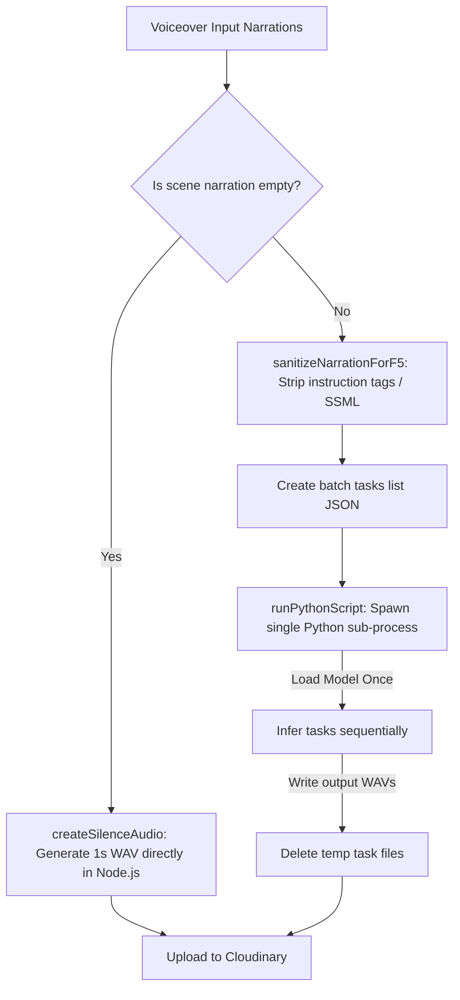

# Advanced Pipeline Features: F5-TTS & AI Scene Queue

> Technical deep-dive into the F5-TTS voice-cloning batch pipeline and the Redis-backed serialized AI scene HTML rendering system.

---

## 1. F5-TTS Voice-Cloning Pipeline

When `VOICEOVER_PROVIDER` is set to `f5`, the pipeline utilizes **F5-TTS**, an open-source neural text-to-speech system, to generate narrations. F5-TTS clones a reference voice from a short sample WAV file.

### High-Level Architecture



### Components and Implementation

#### A. Node.js Service Integration
The core logic resides in [f5-tts-service.ts](file:///c:/Users/susha/OneDrive/Desktop/auto-youtube-channel/workers/voice-over-generation/src/lib/f5/f5-tts-service.ts). It orchestrates:
1. **Config Validation & Paths**: Resolves the reference audio file path (`shorter-better-reference-audio.wav` located in `assets/` or configured via `F5_REFERENCE_AUDIO_PATH`) and the reference transcript text.
2. **Narration Pre-processing**: Cleans up text elements that confuse neural alignment.
3. **Task Assembly**: Pre-configures local file paths (`narration-part-N.wav`) for each scene's audio.

#### B. Text Sanitization Logic
F5-TTS is sensitive to non-pronounceable markers and tags. The service cleanses input text using `sanitizeNarrationForF5()`:
- **Instruction Tags**: Strips tags like `[PAUSE...]` or comments in brackets (`\[.*?\]`).
- **SSML-like Tags**: Strips XML markup (`<[^>]+>`).
- **Hyphenated Words**: Splits hyphens into spaces (e.g., `"low-latency"` $\rightarrow$ `"low latency"`) so F5 does not slur them.
- **Punctuation & Symbols**: Removes formatting markers (`_`, `*`, `~`, `` ` ``) and normalizes long dashes (`–`, `—`) to spaces.
- **Collapsing Punctuation**: Limits repeated exclamation marks or dots (e.g., `"!!!"` $\rightarrow$ `"!"`, `"... "` $\rightarrow$ `". "`).
- **Whitespace**: Shrinks double spaces to single space and trims edges.

#### C. Silence Generation (No-Python Path)
For empty scene narrations (such as hook scenes or intentional visual pauses), spawning Python and running inference is a waste of resources. 
The Node service avoids this entirely by calling `createSilenceAudio()`:
- It creates a raw `Buffer` filled with all-zero PCM samples.
- It adds a standard **44-byte WAV header** (24,000 Hz, 16-bit PCM, Mono).
- It writes the WAV directly to the filesystem in milliseconds.

#### D. Batch Model Inference Execution
Spawning a Python script for *each* individual scene is extremely slow because F5-TTS needs to load PyTorch, weights, and initialize CUDA/CPU resources, which takes around 15–20 seconds per run.

To solve this, the pipeline runs F5-TTS in **batch mode**:
1. The service creates two temporary files in the output directory:
   - A JSON tasks file (`f5_tts_tasks_[rand].json`) listing all non-empty narrations and their respective output file paths:
     ```json
     [
       { "text": "Sanitized scene 1 text...", "outputPath": "/tmp/narration-part-1.wav" },
       { "text": "Sanitized scene 3 text...", "outputPath": "/tmp/narration-part-3.wav" }
     ]
     ```
   - A Python helper script (`f5_tts_batch_[rand].py`).
2. The Node service spawns the Python process (`spawn(pythonBin, [scriptPath])`).
3. The Python script executes the following:
   ```python
   import json
   import soundfile as sf
   from f5_tts.api import F5TTS

   # 1. Load tasks list
   with open(TASKS_PATH, 'r', encoding='utf-8') as f:
       tasks = json.load(f)

   # 2. Instantiate Model ONCE (costly step done once)
   tts = F5TTS()

   # 3. Iterate and infer
   for task in tasks:
       wav, sr, _ = tts.infer(
           ref_file=REFERENCE_AUDIO,
           ref_text=REFERENCE_TEXT,
           gen_text=task['text']
       )
       # 4. Save file
       sf.write(task['outputPath'], wav, sr)
   ```
4. Finally, the temporary script and JSON files are deleted in a `finally` block, and the output WAV clips are uploaded to Cloudinary before local files are cleaned up.

---

## 2. AI Scene Generation (SCENE_RENDER_METHOD=ai)

Each scene is generated through a storyboard-first service: Gemini plans timed visual beats, then a second call creates HTML that follows that direction. If planning or storyboard-directed HTML fails, the service tries direct narration-to-HTML. If direct HTML also fails, the renderer falls back to the script's preserved action list; if that list is missing, it builds a readable title-and-narration card.

Every Gemini network attempt reserves a Redis slot under gemini:request-slot:v1:<bucket>. Slot starts are at least 21 seconds apart per configured project bucket, including retries and model fallbacks. Scene endpoints do not wait in a global ticket queue, so parallel Shorts do not occupy serverless requests while queued behind long-form scenes.

Scene-specific Gemini calls use one bounded attempt and a 60-second HTTP timeout. This keeps the Vercel request bounded and lets the service move promptly through storyboard, direct-HTML, and code-renderer fallbacks. The normal Puppeteer to FFmpeg render pipeline then produces each scene clip.

The scene API keys, models, and limiter buckets are configured separately by GEMINI_DIRECTION_* and GEMINI_HTML_*. When both stages use the same Google project, configure both limiter bucket IDs to the same value so their requests share the same 21-second schedule.