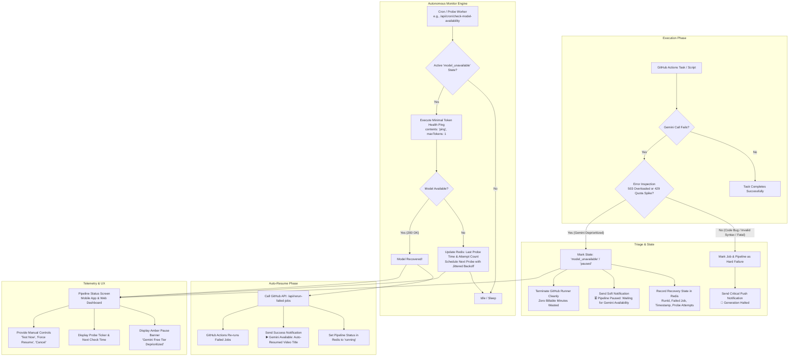

# Feature Specification: Gemini Free-Tier Auto-Recovery & Availability Monitoring System

| Metadata | Details |
| :--- | :--- |
| **Document Name** | Gemini Free-Tier Auto-Recovery & Availability Monitoring System |
| **Status** | **PROPOSED / SPECIFICATION REVIEW** |
| **Version** | `1.0.0` |
| **Target Areas** | Website API, GitHub Actions Workflow, Redis State, Mobile App (Serenity), Web Dashboard |
| **Primary Dependency** | Google Gemini API (Free Tier Quota) |

---

## 1. Executive Summary & Intent

This project operates entirely on the **Google Gemini Free Tier API Quota** across multiple pipeline stages:
- Idea Generation (`populate-ideas`)
- Scriptwriting (`generate-script`)
- Scene Storyboarding & HTML Layout Generation (`render-scenes`)
- Thumbnail Prompting (`generate-thumbnail`)
- Social Shorts Hook & Caption Generation (`process-shorts`)
- Autonomous Comment Replies (`auto-comment-reply`)

Under Google's free-tier policy, during global traffic spikes or regional surges, free requests are dynamically deprioritized. Gemini endpoints reject calls with errors like:
- `503 UNAVAILABLE`: *"The model is overloaded. Please try again later."*
- `429 RESOURCE_EXHAUSTED`: *"Resource has been exhausted (e.g. check quota)."*
- Transient RPC timeouts and gateway drops.

### The Problem
When this happens, the active GitHub Actions job fails, the pipeline aborts, Redis marks the run as a hard failure, and a critical alert (`🚨 PIPELINE ALERT • Generation Halted`) is pushed to the user's mobile device. The user must manually monitor or guess when Google's servers have stabilized, open the app, and tap **"Re-run Failed Jobs"**. If the user retries too soon, the run fails again.

### The Objective
Transform the system from a fragile, fail-stop model into an **autonomous, self-healing pipeline** that:
1. **Intelligently Identifies** when a pipeline job fails due to Gemini capacity deprioritization / overload vs. an actual code bug.
2. **Pauses Gracefully** without burning billable GitHub Actions runner minutes or spinning busy loops.
3. **Autonomously Monitors** Gemini availability via periodic, lightweight health probes.
4. **Auto-Reinitiates** the pipeline (rerunning failed tasks) the moment the model recovers and accepts traffic again.
5. **Provides Live Transparency** on the **Pipeline Status Screen** (mobile app & web dashboard), showing clear explanations, probe timers, last-checked status, and manual overrides.

---

## 2. Architecture & Flow Diagram



---

## 3. Scope Definition

### 3.1. In-Scope (What We Will Build)

1. **Error Classifier Utility (`GeminiErrorClassifier`)**:
   - Detects `503 UNAVAILABLE`, `429 RESOURCE_EXHAUSTED`, `overloaded`, `high demand`, and RPC deadline timeouts across all Gemini callers (`gemini-service.ts`, `scene-html-generation.ts`, `ai-service.ts`, etc.).
   - Distinguishes transient capacity deprioritization from fatal application errors.

2. **Redis State Management & Data Schema**:
   - New pipeline status state: `model_unavailable` (represented smoothly alongside `running`, `success`, `failure`).
   - Hash key `pipeline:model_recovery:state` storing workflow `runId`, failed job name, error snippet, probe attempts, and next scheduled probe time.

3. **Autonomous Availability Prober Engine**:
   - Lightweight, zero-impact health probe hitting Gemini with a 1-token prompt.
   - Serverless probe scheduler (`/api/cron/check-model-availability`) running on a safe, polite backoff cadence (every 2 to 5 minutes with jitter).
   - Maximum timeout safety ceiling (e.g. 90 minutes / 20 probe attempts). If Gemini does not recover within 90 minutes, transitions safely to permanent failure.

4. **Auto-Reinitiation Handler**:
   - Calls GitHub Actions REST API `/actions/runs/{runId}/rerun-failed-jobs` once recovery is verified.
   - Restores Redis status to `running` and clears the recovery state.

5. **Pipeline Status Screen (Serenity Mobile App & Web Dashboard)**:
   - Prominent Amber/Cyan recovery status pill (`⏸️ PAUSED • GEMINI CAPACITY SPIKE`).
   - Informational telemetry banner explaining *why* the pipeline is paused (Gemini Free Quota deprioritization).
   - Live probe ticker: *"Last check: 2m ago (Overloaded) • Next check in: 45s • Attempt 3 of 15"*.
   - User action controls:
     - **Test Model Now**: Immediately fires a probe test without waiting for the timer.
     - **Force Resume**: Immediately re-triggers the pipeline rerun.
     - **Cancel Auto-Resume**: Cancels the auto-recovery watcher and leaves the run halted.

6. **Notification Routing Adjustments**:
   - Suppresses panic/critical alarms when a run is paused for Gemini recovery.
   - Pushes an informational notice when paused, and a celebratory update when auto-resumed.

---

### 3.2. Out-of-Scope (What We Will NOT Build)

1. **Paid Tier Upgrades or Commercial API Provisioning**:
   - The user has explicitly stated the project relies on the **free API quota**. Purchasing credits or moving to a paid tier is out of scope.
2. **Bypassing Google Gemini Rate Limits or SLAs**:
   - We will not attempt brute-force request bombardment or circumvent Google's rate-limiting policies.
3. **Keeping GitHub Actions Runners Alive Waiting for Gemini**:
   - We will **not** implement long `sleep` loops (e.g. `while ! ping; do sleep 60; done`) inside the GitHub Actions runner. Doing so wastes billable CI runner minutes and risks runner timeouts (max 6 hours, usually configured to 10-15m per step). Runners will exit cleanly; monitoring is managed externally via Redis + Serverless.
4. **Modifying Non-Gemini Services**:
   - Steps unaffected by Gemini (Kokoro TTS, Edge TTS, FFmpeg local mixing, Cloudinary uploads, YouTube Data API) remain unchanged.
5. **Alternative LLM Provider Failover (OpenAI / Anthropic)**:
   - Unless explicitly requested in a future phase, failover to external paid providers (OpenAI, Claude) is not part of this scope.

---

## 4. Detailed Functional Requirements

### FR-1: Gemini Error Detection & Classification
A shared error classification function `isGeminiCapacityDeprioritization(error: unknown): boolean` must be implemented:

```typescript
export interface GeminiErrorClassification {
  isCapacityDeprioritized: boolean;
  statusCode?: number;
  reason: 'model_overloaded' | 'quota_deprioritized' | 'rate_limit_surge' | 'fatal_or_other';
  rawMessage: string;
}
```

The classifier must detect:
- HTTP `503` with status text containing `"overloaded"` or `"unavailable"`.
- HTTP `429` with error code `"RESOURCE_EXHAUSTED"` or quota exceeded messages.
- Nested Google GenAI error objects (`error.error`, `error.response.error`, `error.cause`).
- Message phrases: `"The model is overloaded"`, `"Please try again later"`, `"Resource has been exhausted"`, `"Quota exceeded for quota metric"`, `"high demand"`.

### FR-2: Redis State Schema & Lifecycle

When capacity deprioritization occurs, the following Redis keys are updated:

#### 1. `pipeline:status:overall`
- Value: `'model_unavailable'` (or `'paused'`) with TTL 7 days.

#### 2. `pipeline:status:metadata`
- `errorSummary`: `"Gemini free quota deprioritized / model overloaded"`
- `modelPausedStage`: Name of the failed job (e.g. `'generateScript'`, `'renderScenes'`)

#### 3. `pipeline:model_recovery:state` (Redis Hash)
| Field | Type | Description |
| :--- | :--- | :--- |
| `status` | `string` | `'monitoring'` \| `'recovering'` \| `'idle'` \| `'exhausted'` \| `'cancelled'` |
| `videoTitle` | `string` | Human-readable video title (or candidate topic if paused before title generation) |
| `videoId` | `string` | Internal video identifier |
| `runId` | `string` | GitHub Actions workflow run ID (internal backend use only; never shown to user) |
| `failedJob` | `string` | Name of the job that triggered the pause |
| `targetModel` | `string` | Target model name (e.g. `gemini-3.8-flash`) |
| `pausedAt` | `string` | ISO timestamp of the initial failure |
| `lastProbeAt` | `string` | ISO timestamp of the most recent probe |
| `lastProbeStatus` | `string` | `'unavailable'` \| `'available'` \| `'failed'` |
| `lastProbeError` | `string` | Detailed message from the last probe attempt |
| `nextProbeAt` | `string` | ISO timestamp of the next scheduled probe |
| `probeAttempts` | `number` | Count of probes executed so far |
| `maxProbes` | `number` | Maximum allowable probes (default: `18`, ~60-90 mins) |

### FR-3: Autonomous Availability Probe Engine
- **Dedicated Isolated Key (`GEMINI_MONITOR_API_KEY`)**:
  - The probe uses a dedicated key from a **separate Google Cloud project** (`GEMINI_MONITOR_API_KEY`).
  - **Zero Quota Deduction**: Health probes never deduct a single request from your primary video production project's 20 RPD daily quota.
  - Fallback: If `GEMINI_MONITOR_API_KEY` is undefined, falls back gracefully to `GEMINI_API_KEY_2` or the primary `GEMINI_API_KEY`.
- **Probe Route**: `GET /api/cron/check-model-availability` (called periodically or via client-triggered polling).
- **Manual Probe Route**: `POST /api/pipeline-status/probe-model` (for the "Test Now" button).
- **Probe Logic**:
  1. Check if `pipeline:model_recovery:state` has `status: 'monitoring'`. If not, exit immediately with `{ ok: true, active: false }`.
  2. If `probeAttempts >= maxProbes`, transition `pipeline:status:overall` to `'failure'`, set `status: 'exhausted'`, and send a final failure push notification referencing the video title.
  3. Send a minimal request to the model:
     ```typescript
     const response = await genAI.models.generateContent({
       model: targetModel,
       contents: "ping",
       config: { maxOutputTokens: 1, temperature: 0 }
     });
     ```
  4. **If Probe Fails (still overloaded / 503 / 429)**:
     - Increment `probeAttempts`.
     - Update `lastProbeAt` and `nextProbeAt` using exponential backoff with jitter:
       $$\text{Delay} = \min(120\text{s} \times 1.25^{\text{attempts}}, 360\text{s}) + \text{jitter}(0-30\text{s})$$
     - Keep pipeline state as `'model_unavailable'`.
  5. **If Probe Succeeds (200 OK with content)**:
     - Mark `status: 'recovering'`.
     - Automatically trigger `/api/rerun-failed-jobs`.
     - Update `pipeline:status:overall` to `'running'`.
     - Send push notification with the actual video title:
       *"▶️ Gemini Available: Auto-resumed video \"{videoTitle}\""* (e.g. *"▶️ Gemini Available: Auto-resumed video \"The Science Behind Dreams\""*).

### FR-4: Pipeline Status Screen UI/UX Specification

> [!IMPORTANT]
> **User-Facing Title vs Internal IDs Rule:**
> Technical IDs such as `runId` or `run-12345678` must **never** be displayed to the user in the UI, toasts, or push notifications. All screens must present the **Video Title** (e.g., `🎬 "The Science Behind Dreams"`). If the pipeline was paused before title generation (e.g. during `populate-ideas` or early `generate-script`), the UI gracefully falls back to displaying the candidate topic (e.g., `Topic: "Quantum Computing Explained"`) or `Daily Production Video`.

#### Mobile App ([PipelineStatusScreen.tsx](file:///c:/Users/susha/OneDrive/Desktop/auto-youtube-channel/mobile-app/serenity/screens/PipelineStatusScreen.tsx))
1. **Hero Header & Title**:
   - Prominently showcases the **Video Title** (or active Topic) as the primary focal point of the card.
   - Status Badge: `'model_unavailable'`
   - Label: `Model Overloaded • Auto-Monitoring`
   - Colors: Warm amber / glowing amber background (`rgba(245, 158, 11, 0.15)`), border `rgba(245, 158, 11, 0.4)`.
   - Icon: Pulsing radar / hourglass (`timer-outline` or `pulse-outline`).
2. **Dedicated Recovery Banner Card**:
   - **Header**: *"Gemini Free-Tier Capacity Spike"*
   - **Message**: *"Google Gemini is currently experiencing heavy global demand and has temporarily deprioritized free-tier requests. Production of \"{videoTitle}\" has been paused to protect your progress."*
   - **Live Progress Grid**:
     - *Video:* Displays clean video title
     - *Paused Stage:* Script Generation (or Scene Rendering)
     - *Probe Progress:* Attempt 4 of 15
     - *Last Checked:* 1 min ago (Still Overloaded)
     - *Next Automatic Check:* in 42s (live countdown)
   - **Action Buttons**:
     - `[⚡ Test Gemini Now]` (Triggers immediate probe with spinning feedback)
     - `[▶️ Force Resume]` (Calls rerun-failed-jobs immediately)
     - `[✕ Cancel Auto-Resume]` (Aborts monitoring)
3. **Job Stage Indicator**:
   - The specific failed job (e.g. `generateScript` or `renderScenes`) shows a specialized status icon: `pause-circle` with tooltip `"Paused waiting for Gemini"`.

#### Web Dashboard ([DashboardClient.tsx](file:///c:/Users/susha/OneDrive/Desktop/auto-youtube-channel/website/app/dashboard/DashboardClient.tsx))
- Matching amber banner displaying probe attempts, next check countdown, and direct control buttons.

---

## 5. Non-Functional Requirements

1. **Zero Billable Runner Waste**:
   - GitHub Actions runners must exit cleanly with code `0` or appropriate failure step after updating Redis with the recovery state. Runners must never idle waiting for model recovery.
2. **Minimal Probe Overhead**:
   - Health probes must use negligible token quotas (`maxOutputTokens: 1`, prompt `"ping"`) so they do not contribute to rate limiting.
3. **Idempotency & Race-Condition Prevention**:
   - Use Redis locks (`SETNX pipeline:lock:rerun-trigger 1 EX 30`) to ensure a single probe recovery does not trigger multiple duplicate workflow reruns.
4. **Resilience to GitHub Actions Delays**:
   - Handles cases where GitHub Actions has a brief queuing delay before the rerun starts.
5. **Security**:
   - All external triggers and probe endpoints require secret bearer authentication or internal execution tokens matching existing webhook standards.

---

## 6. Implementation Roadmap

| Phase | Milestone | Deliverables |
| :---: | :--- | :--- |
| **Phase 1** | **Error Taxonomy & Classification** | `shared/gemini-error-classifier.ts`<br>Integration into `gemini-service.ts` and pipeline scripts |
| **Phase 2** | **Redis State & Backend APIs** | New Redis schema, `/api/pipeline-status/probe-model`, update to `/api/pipeline-status` GET/POST |
| **Phase 3** | **Prober & Auto-Resume Worker** | `/api/cron/check-model-availability` & trigger logic for `/api/rerun-failed-jobs` |
| **Phase 4** | **Pipeline Status Screen (Mobile App)** | UI Banner, Badge, Countdown Ticker, Action buttons in `PipelineStatusScreen.tsx` |
| **Phase 5** | **Web Dashboard & Notification Tuning** | Dashboard banner in `DashboardClient.tsx`, soft push notifications in Expo push service |
| **Phase 6** | **End-to-End Testing & Validation** | Mocking 503/429 errors, observing graceful pause, probe cycling, and auto-resume |

---

## 7. Approval & Sign-Off

This document serves as the formal specification for the Gemini Free-Tier Auto-Recovery feature. Upon approval, implementation will proceed systematically through Phase 1 to Phase 6.
